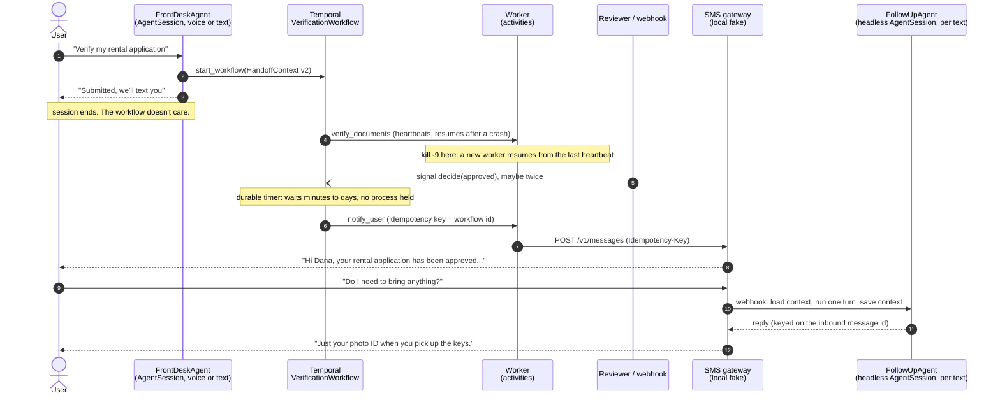

# livekit-durable-handoff

A reference example for [LiveKit Agents](https://github.com/livekit/agents) (Python,
1.8.x): **an agent that takes a request in a live conversation, hands the slow part
to a durable background workflow, and texts the user hours later, picking the
conversation up where it left off.**

```bash
uv sync
uv run python -m durable_handoff.demo --kill-worker   # no API keys, no LiveKit server, ~20 s
```

## The problem

Some requests can't finish while the user waits: a document check, a human
approval, a call to a system that answers tomorrow. LiveKit Agents' async tools
handle work that takes seconds to minutes *inside* a session. Here the work takes
minutes to hours and has to survive two things the session doesn't:

- **The user leaves.** The call ends, the job shuts down, and anything running in
  the process goes with it. Closing a session waits on (or cancels) running async
  tools, and a job gets 10 s to shut down (see [NOTES.md §4](NOTES.md#4-where-long-running-work-falls-outside-a-session)).
- **The worker dies.** A deploy, an OOM, a `kill -9`. Nothing in memory survives,
  and nothing records that the work was in flight.

When the work finishes, the result has to reach the user **once**, on a channel
that works without a live session (SMS here), from an agent that still knows what
was said.

## How it works



Three agents handle one request, in different processes and up to days apart:

| Agent | Runs as | Hands off by |
|---|---|---|
| `FrontDeskAgent` | an `AgentSession`: a LiveKit room (voice), `console --text`, or headless | starting a Temporal workflow with a serialized `HandoffContext` |
| verifier | `VerificationWorkflow` plus activities on a Temporal worker | recording a hop to `follow_up` and texting the user |
| `FollowUpAgent` | a fresh headless `AgentSession` for each inbound SMS | returning a `FrontDeskAgent` from a tool (the framework's in-process handoff) for a new request |

The only thing they share is the **handoff contract**.

## The handoff contract

[`contract.py`](src/durable_handoff/contract.py) defines one frozen, typed,
JSON-serializable object:

```python
class HandoffContextV2(BaseModel):
    schema_version: Literal[2] = 2
    conversation_id: str
    contact: Contact  # name + E.164 phone, validated at the boundary
    request: Request  # kind, documents, notes
    transcript: tuple[Turn, ...]  # role, text, agent, channel
    task: TaskState  # status, workflow_id, detail, updated_at
    hops: tuple[Hop, ...]  # audit trail: from_agent -> to_agent, when, why
```

Agents change it only through `handoff()`, `with_task()` and `with_turns()`, each
of which returns a new object. Version rules:

1. **Writers always write the current version.** Import `HandoffContext`, never a
   numbered class.
2. **Readers accept every older version** and upcast on read (`parse_context`).
   `HandoffContextV1` (flat fields, transcript as one string) is still accepted.
3. **A version newer than the reader is a loud error** (`UnsupportedContextVersion`),
   never a best-effort parse. That makes "deploy readers before writers" a rule
   that breaks visibly when ignored.
4. **Unknown fields are rejected** (`extra="forbid"`), so a typo can't silently
   drop data.

To add v3: copy V2 to V3, add `_upcast_v2`, bump `CURRENT_VERSION`, and add a test
that a v2 payload parses. `test_workflow_started_with_v1_context_completes_on_current_worker`
shows why rule 2 matters: Temporal replays the original input from history, so a
workflow started by last month's deployment hands today's worker a v1 payload.

## Run it

Requires Python 3.11+ and [uv](https://docs.astral.sh/uv/). The first run downloads
the Temporal dev server (about 120 MB on disk, cached in `.temporal-cache/`).

```bash
uv sync
uv run python -m durable_handoff.demo                 # scripted model, offline
uv run python -m durable_handoff.demo --kill-worker   # SIGKILL the worker mid-verification
uv run pytest                                         # 19 tests, ~1 min, offline
```

<details><summary>Demo output (<code>--kill-worker</code>)</summary>

```
== live session with the front desk (text mode)
        user | Hi, I'm Dana Reyes, my mobile is +14155550123.
      (tool) | record_contact({"name": "Dana Reyes", "phone": "+14155550123"})
  front desk | Thanks, Dana! What should we verify, and which documents do you have?
        user | I need my rental application verified. I have a pay stub, a photo ID and a reference letter.
      (tool) | submit_for_verification({"kind": "rental_application", "documents": ["pay stub", "photo id", "reference letter"]})
  front desk | Done. It's with our verification team, and we'll text you when it's finished. You can hang up.
  -- session closed --

== background verification: workflow verify-demo-5f71ec-fbc4011437
  worker SIGKILLed mid-verification. Starting a new one...
  documents checked; waiting on a human reviewer

== reviewer approves (and the webhook is redelivered)
  final status: approved; duplicates ignored: 1
  verification resumed at document 2, not from scratch
  handoff trail: front_desk -> verifier -> follow_up

== the user's phone
      sms in | Hi Dana, your rental application has been approved (income verified). Reply here with any questions.

== user replies by SMS; a new headless session picks the conversation up
     sms out | Great, thanks! Do I need to bring anything to the office?
      sms in | Just your photo ID when you pick up the keys. Congrats!

SMS delivered: 2, send attempts: 2
```
</details>

**With a real model** (optional): `uv sync --extra live`, set `OPENAI_API_KEY`
(or `LIVEKIT_API_KEY`/`LIVEKIT_API_SECRET` to use LiveKit Inference), then
`uv run python -m durable_handoff.demo --live`. Spend is capped at $5 by
[`budget.py`](src/durable_handoff/budget.py), which prices tokens pessimistically
and keeps a ledger in `.budget.json` across runs. A full demo uses a few thousand
tokens.

**Voice** (optional, never needed for tests): run a Temporal server (`temporal server
start-dev`) and a worker (`uv run python -m durable_handoff.worker --gateway-url ...`),
then `uv run python -m durable_handoff.voice console` (add `--text` for the
framework's text console). This needs LiveKit credentials for Inference; see
[`voice.py`](src/durable_handoff/voice.py).

## Tests

All tests run offline. Every agent uses [`ScriptedLLM`](src/durable_handoff/scripted_llm.py),
a small rule-table `llm.LLM`. The fault tests run against a real Temporal dev server
with the worker as a subprocess, so "kill the worker" means `SIGKILL`.

| Test | Proves |
|---|---|
| `test_session_ends_before_task_finishes_then_user_is_texted_and_can_reply` | The work outlives the session. One SMS. The SMS reply is answered by an agent that sees the earlier voice conversation and its own notification. |
| `test_worker_killed_mid_verification_resumes_from_heartbeat` | `SIGKILL` during the activity. A new worker resumes from the last heartbeat (`verify_resumed_from >= 1`). One SMS. |
| `test_worker_killed_while_waiting_for_approval_and_decision_arrives_while_down` | The approval arrives with **no worker running**. It's recorded durably and processed when a worker returns. One SMS. |
| `test_worker_dies_after_sms_sent_but_before_activity_completes` | The hardest case: the side effect happened but Temporal never heard. The retry reaches the gateway with the same key and is deduplicated. Gateway attempts `[new, duplicate]`, one SMS. |
| `test_duplicate_and_conflicting_completion_events` | A redelivered approval and a later conflicting rejection are both ignored. The first decision wins. One SMS. |
| `test_duplicate_submissions_start_one_workflow` | Resubmitting while running and after completion maps to the same workflow. One SMS. |
| `test_redelivered_inbound_sms_gets_one_reply` | A webhook redelivery of an inbound text produces one reply and one transcript entry. |
| `test_follow_up_agent_hands_back_to_front_desk_over_sms` | The framework's in-process handoff inside an SMS session. Who holds the conversation survives into the next text's session. A second durable handoff carries contact details and full history. |
| `test_workflow_started_with_v1_context_completes_on_current_worker` | Across versions, for real: a v1 payload in Temporal history completes on today's worker and is persisted as v2. |
| `test_contract.py` (8 tests) | JSON round trip, v1 → v2 upcast, future versions refused, unknown fields refused, the hop audit trail, and a front desk session → JSON → follow-up session round trip with no tool calls leaking across. |
| `test_budget.py` (2 tests) | The live-demo $5 cap blocks further model turns once reached, including in a later run. |

## Patterns

These are the abstraction choices, with what each one costs.

### 1. Delegate by starting, not by awaiting

`submit_for_verification` is a plain function tool that **starts** a workflow and
returns a sentence for the model. It doesn't await the result and isn't an async
tool. The session has nothing left running, so it can close immediately, and no
`asyncio.Task` holds the request hostage.

*Cost:* the agent can't stream progress into the live conversation the way
`ctx.update()` can. If the user stays on the line, `check_status` has to poll (a
Temporal query). For work under a minute, an async tool is the better fit. Use this
pattern when the work may outlive the session.

### 2. The contract is the only thing that crosses a boundary

Inside a session, use the framework as designed: `userdata` for state, `chat_ctx`
for history, tools that return an `Agent` for handoff. At a process, time or channel
boundary, pass **only** a `HandoffContext`. Two choices inside it:

- **The transcript is our own `Turn` records, not `ChatContext.to_dict()`.** That
  dict has no version and contains framework-internal items, so persisting it ties
  stored data to the framework version that wrote it. `Turn` is ours to version.
- **Tool calls and outputs are dropped at the boundary**
  ([`transcript.py`](src/durable_handoff/transcript.py)). They refer to tools the
  next agent doesn't have, and some providers reject orphaned tool calls (compare
  [#8307](https://github.com/livekit/agents/issues/8307)). The next agent gets the
  conversation plus a structured `task` field for what happened.

*Cost:* lossy by design. If a later agent needs a tool result, put it in the
contract as a typed field, not in the transcript.

### 3. Readers before writers, enforced

Workflow input is a raw `dict`, parsed by `parse_context` inside the workflow, not a
typed parameter. A typed parameter would fail to deserialize an old payload on
replay. Upcasting on read keeps old histories runnable, and refusing newer versions
keeps a half-finished rollout from silently misreading data.

*Cost:* each version stays in the codebase as long as any workflow or stored
context might carry it, which is at least your Temporal retention period.

### 4. At-least-once plus idempotency keys: one notification

Temporal runs activities **at least once**. The user must see a result **exactly
once**. Each place a duplicate can appear has a deterministic key:

| Duplicate source | Key | Where it's deduplicated |
|---|---|---|
| model or user submits twice | `verify-{conversation}-{hash(kind, docs)}` | Temporal workflow ID (`FAIL` conflict policy, reuse only after failure) |
| approval webhook redelivered, second opinion | first `decide` signal wins | workflow state |
| worker dies after sending the SMS | `{workflow_id}/final` | gateway `Idempotency-Key` |
| inbound SMS webhook redelivered | `reply/{inbound_message_id}` | channel plus gateway |
| context saved twice | `conversation_id` | store upsert |

*Cost:* exactly-once is only as good as the downstream's idempotency support. Real
SMS providers vary. If yours has none, record "sent" in your own store inside the
same activity, keyed the same way, and accept a small at-most-once window.

### 5. Signals for outside events, not updates

Approvals arrive as Temporal **signals**, which are recorded durably even when no
worker is running (tested). An **update** would give the sender a synchronous
"accepted" or "duplicate" answer, but it needs a live worker to accept it, which is
the wrong trade for a webhook that may fire during a deploy.

### 6. SMS: load, run one headless turn, save

Each inbound text runs `load context → AgentSession(llm) with no room → session.run(user_input=text) → save context → send reply`
([`sms_channel.py`](src/durable_handoff/sms_channel.py)). Nothing is held between
texts. Two details matter:

- **Persist who holds the conversation.** A handoff inside an SMS session lasts only
  as long as that session, and the new agent can't act until the next user turn (see
  [NOTES.md §3](NOTES.md#3-handoff)). So the active agent is recorded as a hop, and
  the next text rebuilds that agent.
- **One turn at a time per conversation.** Two texts sent back to back would
  otherwise run as two sessions that each overwrite the context.

*Cost:* each text pays session start-up. That's cheap headless with no STT/TTS, but
not free. The per-conversation lock is in-process. With more than one replica you
need a lease or a compare-and-set on the store (Agents 2.0's lanes and leases do
exactly this).

### 7. Resume, don't restart

`verify_documents` heartbeats its progress (`activity.heartbeat(i)`), and a retry
reads `heartbeat_details` to continue from there. Heartbeats are throttled, so a
retry can redo the step in flight. Steps must be idempotent too.

## Gaps and ideas

This is where the framework made the example harder. Each item has a concrete
suggestion. The ones that might be worth filing are drafted, with duplicate searches,
in [DRAFT_ISSUES.md](DRAFT_ISSUES.md). NOTES.md has the evidence.

1. **Session close and long async tools are undocumented, and the behavior is
   surprising.** `session.aclose()` waits for every non-cancellable async tool
   (*verified*: 20 s for a 20 s tool), while the job's shutdown timeout is 10 s.
   *Idea:* document the lifecycle on the async tools page, and add a
   `close_timeout` (or an `on_session_close` hook per tool) so a tool can hand its
   work to something durable instead of being killed partway. Mention "work longer
   than the job" in the docs, with a link to a durable pattern like this one.
2. **No way for an agent to start a message.** Every 1.x output is a reply to a turn
   in a live session. Agents 2.0 calls this "an open design point". *Idea:* an
   egress verb keyed for idempotency, e.g.
   `await thread.send(channel="sms", text=..., key=f"{task_id}/final")`, with
   at-most-once delivery per key. Without the key, every durable caller has to
   rebuild the dedup this example has.
3. **`ChatContext.to_dict()` is not a storage format.** It has no version, and it
   includes internal items and metrics. *Idea:* either document it as unstable and
   point to a stable form (2.0's `livekit.agent.ChatContext.ChatItem` protobuf JSON
   looks like that form), or add `schema_version` and a migration hook to
   `from_dict`.
4. **The handoff turn can't call tools.** After a tool returns an `Agent`, the reply
   runs on the draining activity with `tool_choice="none"`. That's reasonable, but
   it's undocumented, and it makes the "who holds the conversation" state invisible
   to anything outside the session. *Idea:* document it next to "Context
   preservation", and expose the active agent's identity in a serializable form
   (2.0's per-lane "agent stack" does this).
5. **No shipped test doubles.** `tests/fake_llm.py` isn't in the package
   ([#3394](https://github.com/livekit/agents/issues/3394), closed), so every
   example writes its own fake LLM against the internal `LLMStream._event_ch`.
   *Idea:* ship a minimal scripted LLM in `livekit.agents.testing`, as `mock_tools`
   already ships for tools.
6. **2.0: a background task whose worker died has no one to resend it.**
   `storage.md` fails a run with `worker-lost` and expects "the client resends",
   which fits a person typing but not a background task. *Idea:* re-drive
   background-task hooks from the last commit when the lease expires (at least
   once, with `ctx.task_id` as the idempotency key, which the planned doc already
   asks outside calls to use).
7. **2.0: no offline storage.** "Nothing stands in for" agent-db in tests, so a CI
   like this repo's (no network, no account) can't test 2.0's durability. *Idea:*
   publish the local fake from [#8200](https://github.com/livekit/agents/pull/8200)
   as a supported `LocalStorage`.

## Repository map

| Path | What |
|---|---|
| [`contract.py`](src/durable_handoff/contract.py) | `HandoffContext`, versions, upcasting |
| [`agents.py`](src/durable_handoff/agents.py) | `FrontDeskAgent`, `FollowUpAgent`, `SessionState`, workflow start |
| [`workflow.py`](src/durable_handoff/workflow.py) | `VerificationWorkflow`: verify, durable wait, notify |
| [`activities.py`](src/durable_handoff/activities.py) | resumable verification, idempotent notification, fault points |
| [`sms_channel.py`](src/durable_handoff/sms_channel.py) | inbound SMS: one headless `AgentSession` turn per text |
| [`sms_gateway.py`](src/durable_handoff/sms_gateway.py) | local fake SMS provider with `Idempotency-Key` |
| [`store.py`](src/durable_handoff/store.py) | conversation store (SQLite) |
| [`transcript.py`](src/durable_handoff/transcript.py) | `ChatContext` ⇄ `Turn` |
| [`scripted_llm.py`](src/durable_handoff/scripted_llm.py) | offline deterministic `llm.LLM` |
| [`worker.py`](src/durable_handoff/worker.py), [`demo.py`](src/durable_handoff/demo.py), [`voice.py`](src/durable_handoff/voice.py) | entrypoints |
| [`NOTES.md`](NOTES.md) | how the framework handles sessions, state and handoff today, with citations |
| [`DRAFT_ISSUES.md`](DRAFT_ISSUES.md) | proposed upstream issues, unfiled, for review |

## Relation to Agents 2.0

LiveKit's [Agents 2.0 beta](https://github.com/livekit/agents/pull/7757) (staging
only) moves conversations into durable threads, with planned SMS channels and
background tasks. This example targets the stable 1.8 line, and its pieces map onto
2.0 like this: `HandoffContext` is thread state plus the agent stack, `SmsChannel`
is a planned channel, and `VerificationWorkflow` is a planned background
`AgentTask`. The patterns above (idempotency keys, readers before writers, persisting
who holds the conversation) apply to both.

## License

MIT. This is an independent example, not affiliated with LiveKit.
